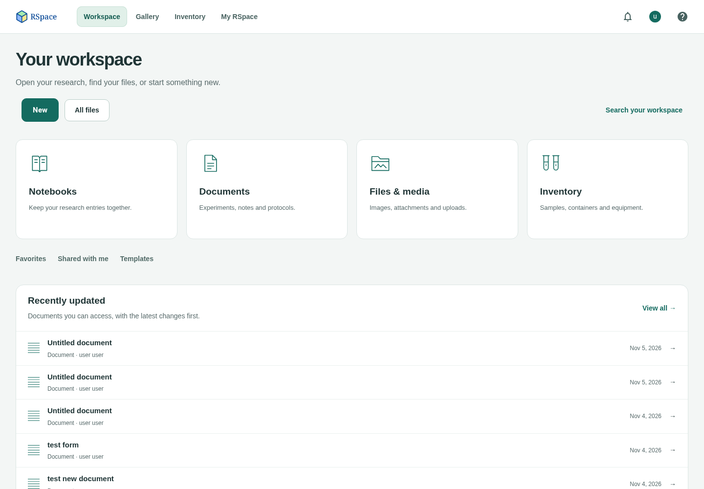
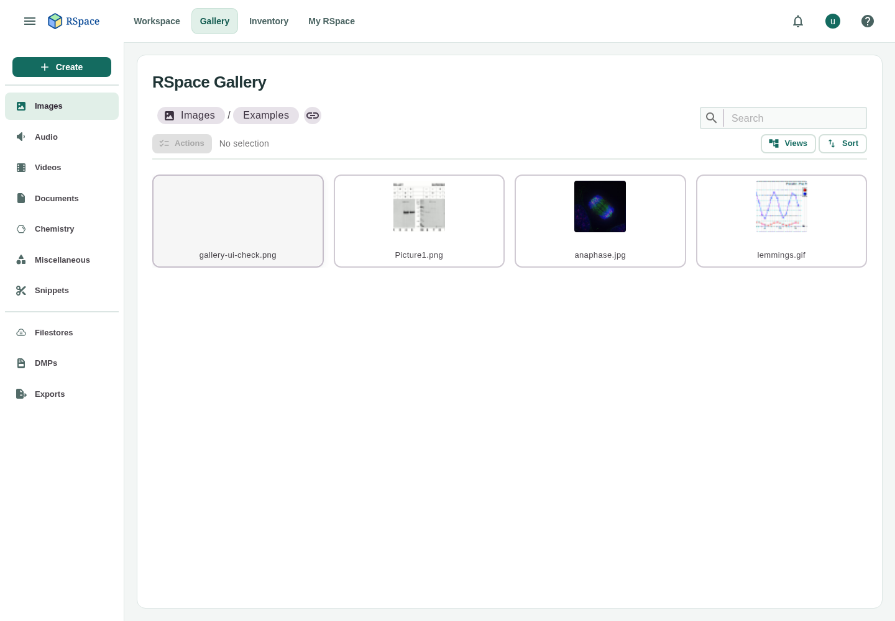
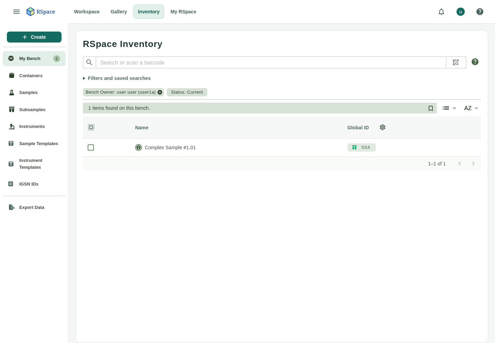
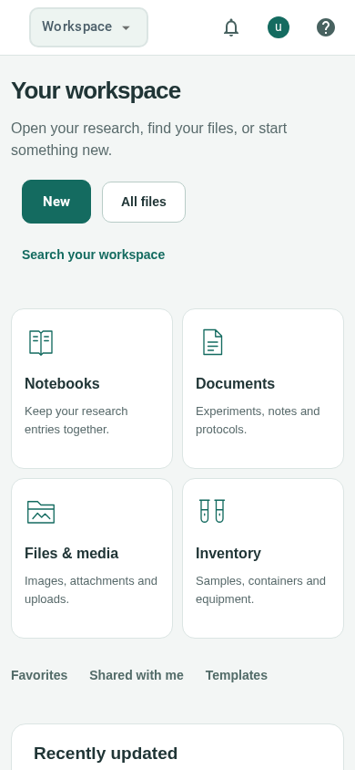

# RSpace Modern UI

An unofficial UI/UX refresh of [RSpace](https://github.com/rspace-os/rspace-web),
with a calmer layout, consistent navigation and responsive administration screens.
This is an independent development fork, not an official RSpace release.

## What changed

- Refreshed login and global navigation.
- Workspace home with recent records and clearer entry points to existing content.
- Updated document editor, form editor and field dialogs.
- Consistent Gallery, Inventory, My RSpace and System navigation.
- Improved account creation, administration tables and mobile layouts.

This is more than a CSS-only theme: it includes React and JSP layout changes,
interaction changes and supporting Workspace controller code. The aim is to retain
RSpace's existing capabilities and permission model. It is not currently a
switchable skin; the modern presentation is part of this branch.

## UI preview

Screenshots from the local development build, using demonstration accounts and
sample data. These show the current interface, not design mockups.

### Workspace

Recent records and clear entry points to notebooks, documents and laboratory resources.



### Gallery

A consistent sidebar and a focused file browser.



### Inventory

A list-first layout with filters available when needed.



### Account creation

Aligned fields, clear account types and grouped administration controls.


### Mobile

The workspace adapts to a narrow screen with compact navigation and stacked content.



## Development status

Experimental and under active development. It has been exercised locally with
Chromium desktop/mobile checks, TypeScript, lint and focused frontend/backend
tests. This is not a fully certified production release or a complete regression
suite across all deployment modes, integrations and browsers.

Known issue: an editor smoke test observed intermittent Fancytree reload assertion
errors even though saving and reopening documents succeeded. External SSO/LDAP
and all third-party integrations have not been validated end to end.

See [implementation and validation notes](DevDocs/DeveloperNotes/GettingStarted/WorkspaceRefresh.md)
for the changes, checks and known limitations.

## Run locally

Clone this repository's default branch, then use the existing per-worktree Docker
development stack:

```sh
git clone https://github.com/dgrotebeverborg/rspace-modern-ui.git
cd rspace-modern-ui
./docker/dev/rspace-dev up
```

The launcher allocates local ports and reports the application URL. Read the
[Docker development guide](docker/dev/README.md) for prerequisites, configuration,
restart behavior and data handling. This stack is intended for local development;
it is not a production deployment configuration.

Local databases, uploads, credentials and development configuration are not included
in this repository. Chemistry and other optional services require their own setup;
the UI changes do not automatically enable them in a new installation.

## Upstream and maintenance

Based on `rspace-os/rspace-web` at commit
[`d73524d64`](https://github.com/rspace-os/rspace-web/commit/d73524d64).
The upstream Git history is retained. UI changes are developed on
`feat/workspace-refresh`, the default branch of this fork. Upstream updates need
merging, conflict resolution where appropriate, and regression checks.

The [original upstream README](README.upstream.md) contains RSpace's overview,
community links and deployment documentation. Those links describe the upstream
project; its support and release guarantees do not apply to this fork.

## License and attribution

The original [GNU Affero General Public License v3](LICENSE) and copyright notices
are retained. RSpace and the original application are the work of their respective
contributors; this repository adds an unofficial presentation refresh.
